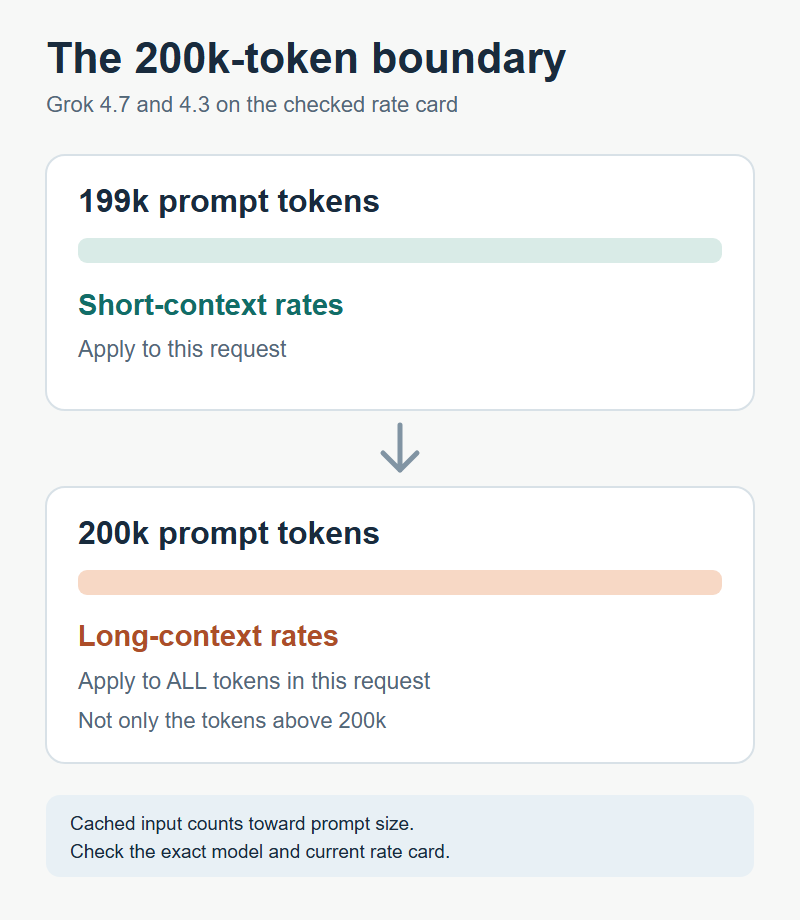

# Grok API Pricing: What Changes the Cost of Each Request?

*Cover illustration: the bill for one Grok text request can contain several separately metered components. Conceptual artwork; no price or product capability is implied.*

A Grok text API request can cost more than a model's headline input rate suggests. To estimate it, choose the **exact model and context band**, separate uncached input from cached input, count output and reasoning tokens, then add any server-side tool charges. Batch, priority processing and the US regional endpoint can change the token rate when their conditions apply. Check the estimate against the cost reported for the actual request, followed by cost per answer that passes your product’s acceptance bar.

This guide covers xAI's text API, not the separately priced Imagine image/video or Voice APIs. The [consumer plan page](https://x.ai/pricing) is also a different starting point from the developer token schedule. Public documentation was checked on November 2, 2026; rates and model access can change. Moduck publishes this article as an AI API aggregator, but its Grok-specific access and pricing were not verified for this guide.

## Read the model rate in the right context band

The table shows two representative models from [xAI's API pricing page](https://docs.x.ai/developers/pricing). Prices are **USD per one million tokens** on the global endpoint at standard, real-time text rates. They exclude server-side tools and any eligible priority or regional modifier. The long-context threshold is **200,000 prompt tokens** for both models; cached prompt tokens count toward that threshold.

| Model | Prompt size | Uncached input / 1M | Cached input / 1M | Output / 1M |
| --- | --- | ---: | ---: | ---: |
| `grok-4.7` | Below 200k | $2.00 | $0.50 | $6.00 |
| `grok-4.7` | 200k or more | $4.00 | $1.00 | $12.00 |
| `grok-4.3` | Below 200k | $1.25 | $0.20 | $2.50 |
| `grok-4.3` | 200k or more | $2.50 | $0.40 | $5.00 |

Once a prompt reaches the applicable long-context threshold, xAI says the **long-context rates apply to all tokens in that request**, not just the tokens above 200k. A context window's maximum size is therefore not a promise of one flat price. The lower listed rate for `grok-4.3` also says nothing by itself about whether its answers meet your quality bar. Check the exact model ID, availability and current schedule before choosing which route to pilot.

*For `grok-4.7` and `grok-4.3` on the checked xAI rate card, reaching 200k prompt tokens switches the rate for the entire request. Cached input counts toward that threshold.*

## Price one representative request

Suppose a **hypothetical** `grok-4.7` request on the global standard tier stays below 200k prompt tokens. Its measured usage is 2,000 uncached input tokens, 6,000 cached input tokens and 1,000 output tokens, including any reasoning. It invokes Web Search once. Using the listed rates:

- Uncached input: 2,000 × $2.00 / 1,000,000 = **$0.004**.
- Cached input: 6,000 × $0.50 / 1,000,000 = **$0.003**.
- Output: 1,000 × $6.00 / 1,000,000 = **$0.006**.
- One successful Web Search invocation: $5 / 1,000 calls = **$0.005**.

**Estimated request cost under these assumptions: $0.018.** The same 8,000 input tokens would cost more without the assumed cache hit. This is arithmetic from a stated usage mix, not an invoice or a result we generated. A real agent may make a different number of tool calls and produce more tokens than expected; record actual usage rather than treating the example as a fixed price per question.

## What changes token and tool charges?

### Cache hits depend on the request you actually send

A repeated prompt prefix can receive xAI's lower cached-input rate. The [prompt-caching usage guide](https://docs.x.ai/developers/advanced-api-usage/prompt-caching/usage-and-pricing) shows `cached_tokens` in the response and explains that zero means no cache hit. Editing or reordering earlier conversation content can break the reusable prefix. Estimate with the *observed* cached count; do not apply the discount to every input token because a prompt looks similar. Cached tokens still count toward the long-context threshold.

### Long prompts and reasoning change the expensive side of the bill

In a multi-turn chat, the sent history may grow even when the newest user message is short. Crossing the model's threshold changes the rate for the whole request. Reasoning tokens are billed at the output rate, so a short visible answer need not mean a small output charge. xAI also notes in its [billing FAQ](https://docs.x.ai/developers/faq/billing) that inference token counts can differ from a standalone tokenizer's count. Set a representative output budget and verify usage from responses.

### Server-side tools add their own units

Web Search is listed at $5 per 1,000 successful calls. [X Search billing](https://docs.x.ai/developers/tools/x-search) is different: it charges by posts and user profiles fetched, at the published per-item rates, and the response exposes those counts. A tool-enabled agent can decide to fetch multiple items or make several calls. Include both its model tokens and the tools it actually uses. A custom function your own application executes is a separate operational cost; do not label it an xAI server-side tool fee.

## Check route and processing modifiers

**Batch for work that can wait.** The [Batch API](https://docs.x.ai/developers/advanced-api-usage/batch-api) queues requests rather than returning an interactive answer. The pricing page lists a 20% discount on token categories for specific text models, including the two in the table; it does not make every model or tool fee 20% cheaper. Most batches complete within 24 hours according to the guide, but that is not a guaranteed deadline. Choose it for eligible background jobs only when delay and result handling fit the product.

**Priority for latency-sensitive work.** [Priority Processing](https://docs.x.ai/developers/advanced-api-usage/priority-processing) charges 2× standard token rates when the response confirms `service_tier: priority`; a request served at the default tier uses standard rates. Its purpose is higher scheduling priority, not a documented guarantee that your own end-to-end latency will meet a target. Compare the premium against measured user-facing benefit before enabling it.

**US regional endpoint for a specific location requirement.** The [regional-endpoint guide](https://docs.x.ai/developers/advanced-api-usage/regions) lists a 10% premium on token usage and currently names `grok-4.7` and `grok-4.6` for that route. The document defines what its US processing guarantee covers and excludes server-side tools and some other services. Do not infer full data residency from the endpoint name alone; confirm the exact requirement and current supported models.

These are separate choices. Do not multiply every listed modifier into one default quote: first establish which model, endpoint and processing mode your request actually uses, then apply the applicable terms.

## Use the response cost to verify the estimate

For a direct xAI request, the [cost-tracking guide](https://docs.x.ai/developers/cost-tracking) says the response's `usage.cost_in_usd_ticks` reports the amount charged for that request, including token and server-side tool costs after applicable discounts. Divide ticks by **10,000,000,000** to convert to US dollars. It is a per-request field, so sum it across turns, retries and tool-heavy steps to see a workflow's total. For streaming through the OpenAI SDK or REST, the guide says to request usage in the final chunk.

Compare the estimate with that field and investigate differences in cached counts, output/reasoning tokens, context tier and tools. Then track **total workflow charges ÷ acceptable completed answers** on a comparable sample, alongside latency and failure rate. A lower rate per token can lose its appeal if it needs more calls or manual correction. This is a test to run on your own workload, not a claim that one Grok model performs better than another.

A third-party or aggregated route may expose a different billing record. Do not assume xAI's direct-response cost field or list rates describe a Moduck invoice; check that route's current model, account and price terms separately.

## Choose a budgeted route, then check access

For a short, plain-text workflow, start with the exact model and standard tier that satisfy your quality and latency requirements, then compare accepted-answer cost. For research agents, include the *actual* Web or X Search usage before choosing. For large background queues, test Batch only if its eligible-model discount is worth delayed results. Priority or the US endpoint is justified by a real latency or location need, not by a lower sticker price.

Direct xAI access remains a valid choice. Moduck focuses on model discovery, pricing information and unified API access, but this article does not establish that a particular Grok model is available to your Moduck account or cheaper there. If a unified API route remains on your shortlist, check its current model, price and endpoint documentation before integrating. [Read the documentation](https://docs.moduck.ai/). Confirm Grok availability and account terms; this article does not establish a Moduck price advantage.
